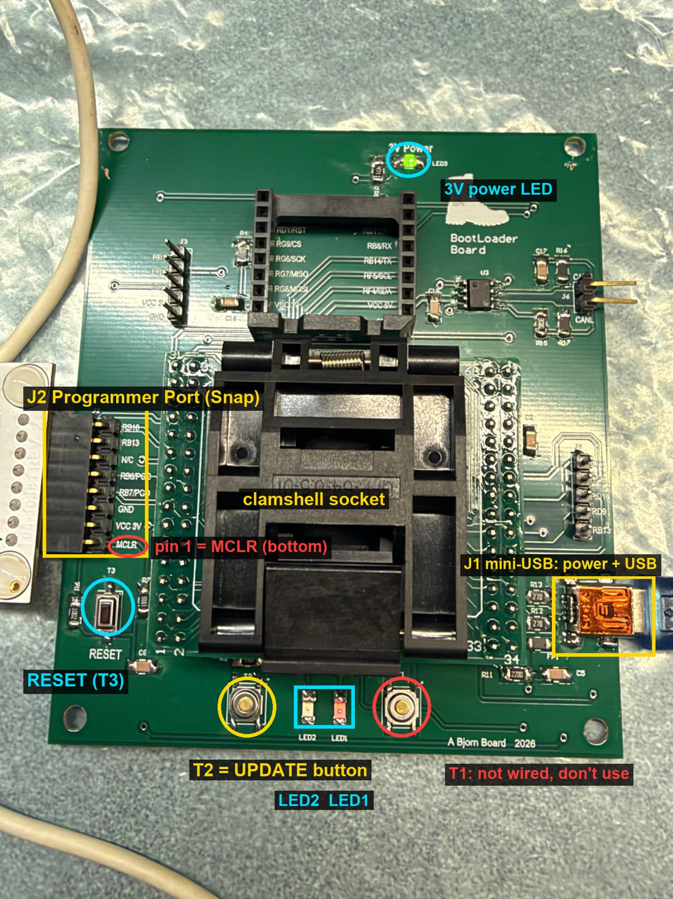
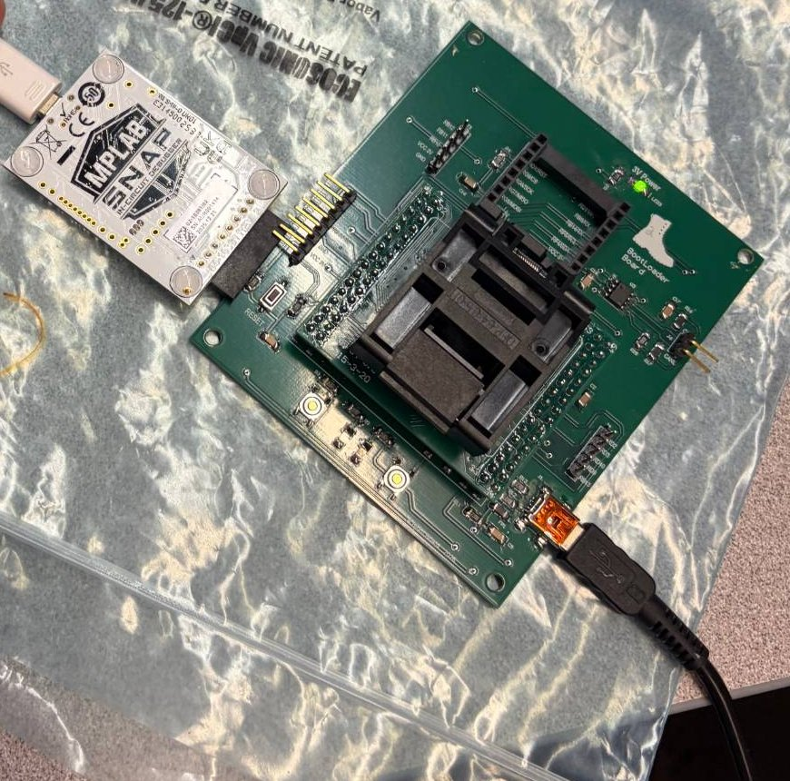
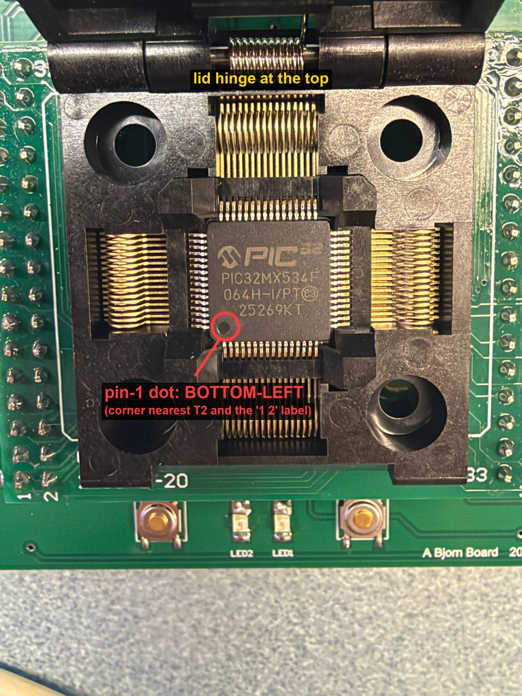

# Part 1 — Lab Tech guide: loading the bootloader onto chips

**Who this is for:** lab leads and techs preparing PIC32MX534F064H chips for the
class. You load the **USB bootloader** onto each bare chip once, using this
programmer board and an MPLAB Snap. After that, students load their own code
over USB without any programmer (that's [Part 2](../team-guide/README.md)).

**What you'll do:** set up a PC once, then for each chip: drop it in the socket,
press Enter, wait about a minute, read PASS or FAIL. The **Load Bootloader**
tool does the programming, the checks and the log for you.

- [What you need](#what-you-need)
- [One-time PC setup](#one-time-pc-setup)
- [Connect the hardware](#connect-the-hardware)
- [Placing a chip in the clamshell](#placing-a-chip-in-the-clamshell)
- [Load chips with the tool](#load-chips-with-the-tool)
- [The LED test](#the-led-test)
- [Common errors and quick fixes](#common-errors-and-quick-fixes)
- [Doing it by hand in MPLAB IPE](#doing-it-by-hand-in-mplab-ipe-fallback)

---

## What you need

| Item | Notes |
|---|---|
| Windows 10/11 PC | Admin rights needed once, to install MPLAB X. |
| This programmer board | The green "BootLoader Board" with the clamshell socket. |
| MPLAB Snap (PG164100) | The white Microchip programmer. A PICkit 4 also works. |
| USB cable for the Snap | **USB-A to micro-USB (Micro-B)**, data cable. |
| USB cable for the board | **USB-A to mini-USB (Mini-B)**, data cable. |
| PIC32MX534F064H-I/PT chips | 64-pin TQFP. Keep them in their tray until used. |
| Two trays or bags | Label them **DONE** and **FAILED**. |
| ESD wrist strap or mat | Recommended when handling bare chips. |

> **Data cables matter.** Many micro/mini-USB cables only charge. If the PC
> never sees the Snap or the board, try another cable first.

---

## One-time PC setup

### 1. Install MPLAB X IDE (includes MPLAB IPE and the Snap driver)

1. Go to <https://www.microchip.com/mplab/mplab-x-ide> and download **MPLAB X
   IDE for Windows**. v6.30 was used to validate this guide.
2. Run the installer **as administrator**. On the component page keep
   **MPLAB IPE** ticked. (MPLAB X IDE itself is optional for lab techs, but
   install it if this PC will also build code.)
3. On the **device support** page, make sure **32-bit MCUs** are included.
4. Finish the installer and let it install the USB drivers.

You do **not** need XC32, MCC or Harmony just to load bootloaders.

### 2. Download this repository

1. Open <https://github.com/bjornhbengtsson/pic32mx-programmer-pcb>.
2. Click the green **Code** button → **Download ZIP**.
3. Go to your **Downloads** folder. Right-click the ZIP → **Properties** → if
   there is an **Unblock** checkbox at the bottom, tick it → **OK**.
   (This stops Windows warning about every file.)
4. Right-click the ZIP → **Extract All…** → choose a place such as
   `Documents` → **Extract**.

   > Always use the **extracted** folder. The tools do not work if you run them
   > from inside the ZIP. Inside a ZIP, the details pane shows "Compressed size".

### 3. Put the Load Bootloader tool on your desktop

1. In the extracted folder, open `tools\load-bootloader\`.
2. Right-click **Load Bootloader** (type "Windows Command Script").
3. Click **Show more options** at the bottom of the menu (or press
   **Shift+F10**) → **Send to** → **Desktop (create shortcut)**.

The first time you double-click it, Windows may show **"Windows protected your
PC"**. Click **More info** → **Run anyway**.

---

## Connect the hardware

### Know the board



Hold the board so the text reads normally: **RESET** bottom-left, the
**mini-USB** socket bottom-right, the clamshell's hinge at the top.

| Part | Where | What it's for |
|---|---|---|
| **J2 Programmer Port** | Left edge, 8 pins | The Snap plugs in here. Pin 1 (**MCLR**) is the **bottom** pin, next to RESET. |
| **RESET (T3)** | Bottom-left | Restarts the chip. |
| **T2** | Bottom, left of the LEDs | Update button (hold + RESET = update mode). |
| **T1** | Bottom, right of the LEDs | **Not wired on this board revision. Don't use it.** |
| **LED2 / LED1** | Bottom centre | LED2 steady = update mode. Both taking turns = LED test app. |
| **J1 mini-USB** | Bottom-right | Power for the board, and USB to the PC. |
| **3V power LED** | Top centre | On when the board has power. |

### Plug things in



1. **Snap → board.** Push the Snap's 8-pin connector straight onto **J2**.
   The Snap lies **flat, label facing up**, its USB socket pointing **away**
   from the board, as in the photo. The J2 pins are labelled on the board;
   the bottom one is **MCLR**, and the Snap's **▼ arrow (pin 1) must be at
   that bottom end**, next to RESET.
   Push it fully on. A half-seated Snap is the most common cause of "device
   not found".
2. **Snap → PC.** Micro-USB cable from the Snap to the PC. The Snap's light comes on.
3. **Board → PC.** Mini-USB cable from **J1** (bottom-right) to the **same PC**.
   The **3V power** LED comes on.

   The board can also be powered from a USB wall charger, but then the tool
   cannot run its automatic USB check, so the PC is strongly preferred.

> **Never** turn on "power target from tool" in MPLAB IPE. The board powers
> itself from its USB cable. The Snap only senses the voltage.

---

## Placing a chip in the clamshell

The chip fits correctly only one way round. Getting it wrong can damage the chip.



1. **Unplug the board's USB cable first.** Never open the socket with power on.
2. Open the clamshell lid. It hinges at the **top** of the socket.
3. Find **pin 1** on the chip: a small round **dot** in one corner of the top.
   With the "PIC32MX534F" text readable, the dot is at the **bottom-left**.
4. Lay the chip in flat with the **dot in the bottom-left corner**, the corner
   nearest the **T2** button and the **"1 2"** header label, with the text
   reading the right way up. All four rows of legs rest in the guides. Don't
   press on the legs.
5. Close the lid and **latch it fully** (see the board photo above). It
   should sit evenly.

Handle chips by the edges with tweezers or a vacuum pen. Bent legs mean
"device not found".

---

## Load chips with the tool

1. Close **MPLAB IPE** and **MPLAB X** if they're open (they can lock the Snap).
2. Double-click **Load Bootloader** on the desktop.
3. The tool checks the PC: firmware files, MPLAB IPE, the Snap. Fix anything it
   reports in red.
4. Choose a mode (see [Which mode should the class use?](#which-mode-should-the-class-use)):
   - **1 — Load bootloader** for normal batches.
   - **2 — Load bootloader + LED test** for the first chip of the day, or any
     chip you're unsure of. See [The LED test](#the-led-test).
   - **3 — Load bootloader + LED app, keep it** if the course wants chips to
     blink their LEDs as soon as students solder them.
5. For each chip the tool tells you what to do:
   1. Unplug the board's USB cable.
   2. Swap the chip (old one to **DONE**, new one in, pin 1 aligned, lid latched).
   3. Plug the board's USB cable back into the PC.
   4. Press **Enter**.
6. Wait about a minute. The tool programs, verifies, then checks the
   bootloader actually starts. You'll see one of:

   ```text
   >>> CHIP 7 PASS - mark it and put it in the DONE tray <<<
   >>> CHIP 8 FAIL - set it aside, then try it once more <<<
   ```

   On a PASS, **LED2 is on and steady**: that's the bootloader waiting.
7. Type **Q** and Enter when you're finished. The tool prints a summary.

Every chip is logged in `logs\load-bootloader-<date>.csv` (time, chip number,
checksum, LED test, USB check, PASS/FAIL), with the full programmer output next
to it for troubleshooting.

### What PASS means

- The bootloader was written and read back correctly (verify).
- The chip **ran** it: the crystal, PLL and USB work, and Windows saw the
  bootloader as USB device `04D8:003C`.

In modes 1 and 2, chips leave with **only** the bootloader: with no app
installed, the chip always starts in update mode, so students can load their
first program over USB on their own boards. Mode 3 is different, see below.

In mode 3 the tool can't run the USB check (the chip starts the LED app, which
has no USB), so **PASS means you answered Y to "are the LEDs blinking?"**. Run
the first chip of each session in mode 2 so the USB path is checked too.

### Which mode should the class use?

| | Modes 1/2: bootloader only | Mode 3: bootloader + LED app |
|---|---|---|
| What the chip does when the student powers their board | Starts in **update mode**, ready for code over USB. LED2 (RD1) lights. | **Blinks LEDs on RD4 and RD1** straight away. |
| Good for | Students load their own code first thing | A quick "my soldering works" check |
| Student board needs, to see anything | USB wired up (Windows shows the device) | LEDs on **RD4 and RD1** |
| Student board needs, to load their own code over USB | USB wiring | USB wiring **and the RB0 update button** (hold it + reset). Without the button, only a Snap/PICkit can replace the LED app. |
| Pins driven by the chip before the student's code runs | RD1 (only while in update mode) | RD4 and RD1, toggling forever |

Decide this with the course staff before loading a batch, and tell students
which one they got. Their board checklist is
[Using the bootloader on your own board](../team-guide/own-board.md).

---

## The LED test

Mode 2 proves the whole chain on a chip: bootloader → finds an app → jumps to
it → app runs.

1. The tool programs the bootloader **plus** the LED test app.
2. It asks: **are LED1 and LED2 taking turns blinking?** Look at the board and
   answer **Y** or **N**.
3. It then reprograms the bootloader only, which removes the LED app, and runs
   the normal USB check.

Do this for the first chip of each session. If it passes, mode 1 is enough for
the rest of the batch.


To test the **USB update path** too (bootloader receives an app over USB), use
[Part 2, Task 2](../team-guide/README.md#task-2-put-new-firmware-on-the-board)
with `firmware\prebuilt\test_app_pic32mx534.hex`. Reload the bootloader
afterwards if the chip is going to a student.

---

## Common errors and quick fixes

| What you see | Most likely cause | Fix |
|---|---|---|
| Tool: "MPLAB Snap not found on USB" | Snap cable unplugged, charge-only cable, driver missing | Replug the micro-USB; try another cable; re-run the MPLAB X installer to install drivers. |
| Tool: "MPLAB IPE not found" | MPLAB X / IPE not installed | Do [One-time PC setup](#1-install-mplab-x-ide-includes-mplab-ipe-and-the-snap-driver). |
| Tool: "does not match SHA256SUMS.txt" | Firmware file changed or partly downloaded | Download and extract the repository again. |
| "Windows protected your PC" | Script downloaded from the internet | **More info → Run anyway**, or unblock the ZIP before extracting. |
| Tool won't run at all / closes instantly | Run from inside the ZIP | Extract the ZIP and run it from the extracted folder. |
| FAIL, "The Snap could not see the chip" | Chip backwards, not seated, lid not latched, bent legs | Unplug board, reseat chip (pin 1!), latch lid, retry. Try a known-good chip. |
| FAIL, voltage message | Board not powered or Snap not fully on J2 | Check board power LED and mini-USB; push Snap fully on. |
| FAIL every time, even good chips | Snap on backwards, or IPE/MPLAB X holding the Snap | Check the Snap matches the photo; close IPE/MPLAB X. |
| Programmed OK, "did not show up on USB" | Board on a wall charger, charge-only cable, or chip not running | Plug the board into this PC with a data cable; check LED2; reseat and retry. |
| LED test: LEDs don't blink | Chip programs but doesn't run the app | Reseat the chip and retry once; otherwise put it in FAILED. |
| A chip fails twice | Damaged chip | Put it in **FAILED**. Note the chip number from the log. |

---

## Doing it by hand in MPLAB IPE (fallback)

Use this if the tool can't run on a PC.

1. Open **MPLAB IPE**. Device: `PIC32MX534F064H` → **Apply**. Tool: your Snap.
2. **Settings → Advanced Mode** (password `microchip`) → **Power** → make sure
   power-from-tool is off. If Connect later says *"invalid value (null) for the
   Voltage Level"*, click **Reset to defaults** here, and see
   [`PROGRAM_WITH_PICKIT4_OR_SNAP.md`](../../firmware/bootloader/PROGRAM_WITH_PICKIT4_OR_SNAP.md).
3. **Operate** → **Connect**. Expect "Target device PIC32MX534F064H found".
4. **Hex File → Browse** → `firmware\prebuilt\bootloader_pic32mx534.hex`.
5. **Program**. Expect "Programming/Verify complete".
6. Click **Disconnect** (otherwise the Snap holds the chip in reset).
7. LED2 should come on steady. Windows shows a "USB Input Device".

For the LED test by hand, program `bootloader_plus_led_test.hex` instead,
check the LEDs alternate, then program `bootloader_pic32mx534.hex` again.

---

**Next:** chips that PASS go to the students. Loading their own code over USB
is [Part 2 — Team guide](../team-guide/README.md).
