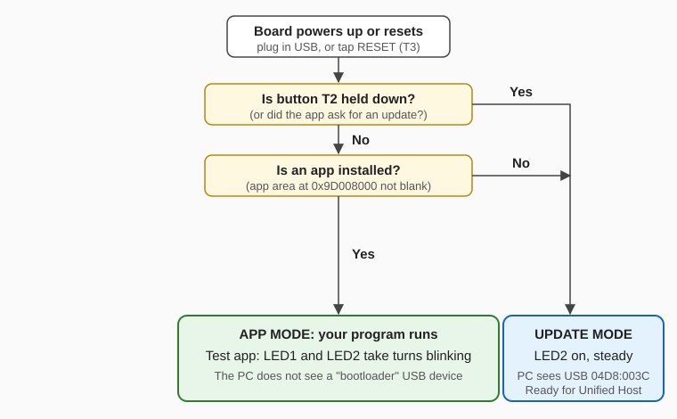
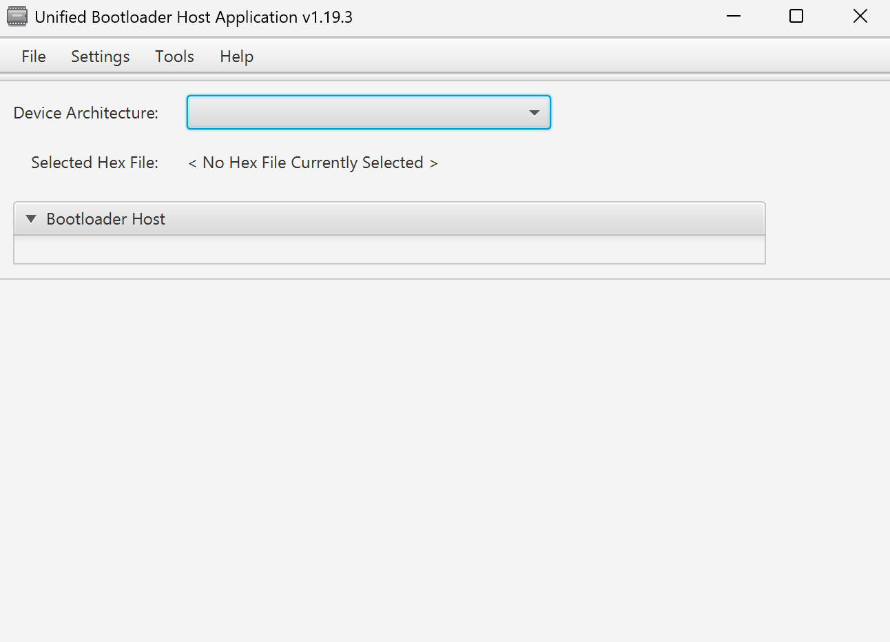
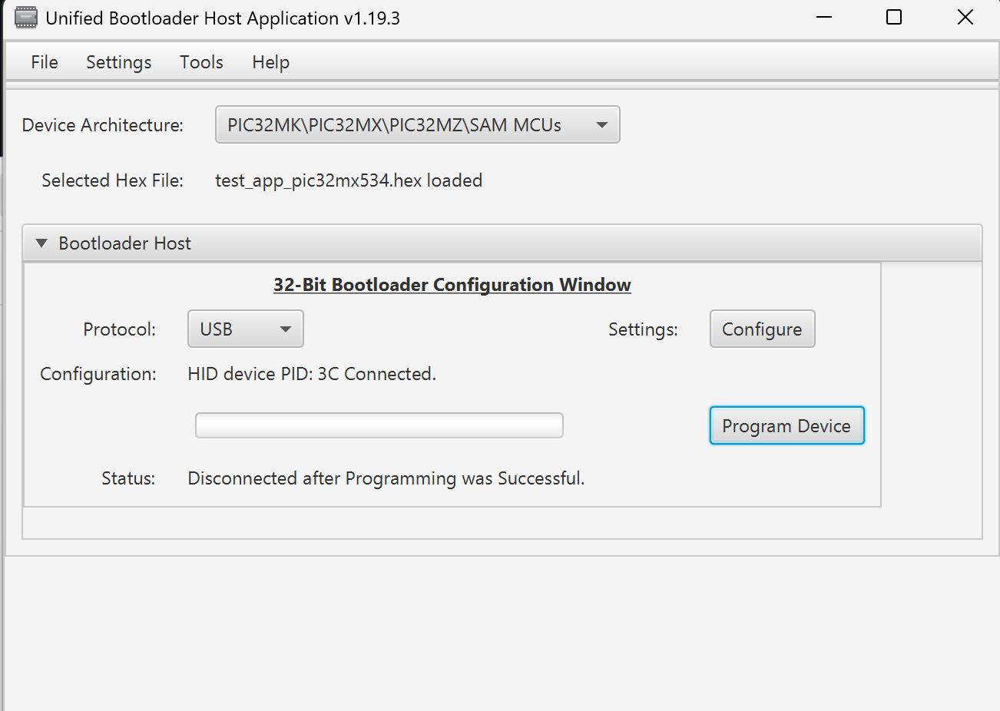

# Team guide: running and updating the PIC32MX534 board

This guide is for anyone who needs to **run** code on the board or **put new
code on it**. You do not need a programmer (Snap/PICkit) for any of this, only
a USB cable.

- [How the board starts up](#how-the-board-starts-up)
- [One-time PC setup](#one-time-pc-setup)
- [Task 1: Run the app](#task-1-run-the-app)
- [Task 2: Put new firmware on the board](#task-2-put-new-firmware-on-the-board)
- [Task 3: Write and build your own app](#task-3-write-and-build-your-own-app)
- [Troubleshooting](#troubleshooting)
- [If the board is completely stuck](#if-the-board-is-completely-stuck-needs-a-snap-or-pickit)

---

## How the board starts up

The chip has two programs on it:

| Program | What it does | Who changes it |
|---|---|---|
| **Bootloader** | Runs first, every time. Decides whether to start your app or wait for an update. | Nobody, normally. It is installed once with a Snap/PICkit. |
| **App** | Your program. | You, over USB, as often as you like. |



**Read the LEDs to know which mode you are in:**

| You see | Mode | Meaning |
|---|---|---|
| LED1 and LED2 take turns blinking | App mode | The test app is running. (Your own app may do something else.) |
| LED2 on, not blinking | Update mode | The board is waiting for new firmware over USB. |
| Nothing lit | — | No power, or your app does not use the LEDs. |

**Buttons:**

| Button | Name on schematic | Use |
|---|---|---|
| **T2** | Update button | Hold during reset to enter update mode. |
| **T3** | RESET | Restarts the board. |
| T1 | — | **Does nothing** on this board revision (it is not wired to the chip). Don't use it. |

> Plugging in the board does **not** open anything on the PC. The board just
> runs. You open Unified Host yourself when you want to update it (Task 2).

---

## One-time PC setup

Do this once per PC.

1. **Install MPLAB X IDE** (v6.30 was used) with **XC32** (v5.10 was used).
   MPLAB X includes the Java runtime that Unified Host needs.
2. **Install the Harmony 3 `bootloader` package**, which contains Unified Host:
   open MPLAB X, open **MCC** (MPLAB Code Configurator) on any project, and
   install the **bootloader** content from the Content Manager. Unified Host
   ends up under `%USERPROFILE%\.mcc\harmony\content\bootloader\<version>\tools\`.
3. **Get this repository** (clone or download ZIP) onto the PC.
4. Optional: right-click [`tools/update-board/Update Board.cmd`](../../tools/update-board/)
   → **Send to → Desktop (create shortcut)**.

The USB bootloader uses the standard Windows HID driver, so there is **no
driver to install**.

---

## Task 1: Run the app

1. Plug the board's USB cable into the PC (or any USB power).
2. That's it. If an app is installed, it starts within about a second.

With the test app you'll see LED1 and LED2 taking turns.

---

## Task 2: Put new firmware on the board

You need an **application** `.hex` file, for example
[`firmware/prebuilt/test_app_pic32mx534.hex`](../../firmware/prebuilt/) or one
you built in Task 3.

> **Never** load `bootloader_pic32mx534.hex` here. That file is only for the
> Snap/PICkit. Unified Host is only for app `.hex` files.

### Step 1: Put the board in update mode

1. Plug the board's USB cable into the PC.
2. **Press and hold T2.**
3. **While holding T2, tap RESET (T3).**
4. **Let go of T2.**
5. Check: **LED2 is on and steady.** The app's blinking has stopped.

(Holding T2 while plugging in the USB cable works too.)

> Use **T2**, not T1. T1 is not connected to the chip on this board revision.

### Step 2: Open Unified Host

Double-click **`tools/update-board/Update Board.cmd`**.

A black window checks that the board is in update mode, then opens Unified
Host. If the board is not in update mode yet, the window tells you the button
steps and waits.

### Step 3: Set up Unified Host

Unified Host **does not remember settings**. Every time it opens it looks like this:



1. **Device Architecture:** choose **PIC32MK\PIC32MX\PIC32MZ\SAM MCUs**.
2. **Protocol:** choose **USB**.
3. Check that it says **`HID device PID: 3C Connected.`**
   If it shows a different PID, click **Configure** and set Product ID to `3C`.

### Step 4: Load the hex file and program

1. **File → Open Hex File**, then choose your `.hex`.
2. Check **Selected Hex File** shows your file name.
3. Click **Program Device**.
4. Wait for the bar to finish. It should end like this:



`Disconnected after Programming was Successful.` is the good result. The
board has restarted into your new app, so it is no longer an update-mode USB
device.

5. Check the board: your app should be running (test app: LEDs take turns).

To update again, go back to Step 1.

---

## Task 3: Write and build your own app

Start from the test app. It already has the memory layout the bootloader needs.

1. Copy the folder [`firmware/test_app`](../../firmware/test_app/) to a new
   folder, for example `firmware/my_app`.
2. Edit `main.c`. Keep these rules:

   | Rule | Why |
   |---|---|
   | Keep using `app_mx534.ld` | It puts your code above the bootloader. Without it you would erase the bootloader. |
   | **No `#pragma config` lines** | The bootloader owns the configuration bits. |
   | The CPU runs at **80 MHz**, peripheral clock **80 MHz** | Set by the bootloader (8 MHz crystal + PLL). The core timer ticks at 40 MHz. |
   | Leave the first 16 bytes of RAM alone | Reserved for "app asks for update mode" (the linker script already does this). |

3. Build it (PowerShell, from the repository folder):

   ```powershell
   powershell -ExecutionPolicy Bypass -File firmware\my_app\build.ps1
   ```

4. **Check it before you load it.** Both must say `PASS`:

   ```powershell
   python firmware\bootloader\scripts\hex_layout.py --mode application firmware\my_app\test_app_pic32mx534.hex
   python firmware\bootloader\scripts\verify_project.py --application firmware\my_app
   ```

   `FAIL` means the file would damage the bootloader or change its settings.
   Do not load it; fix the error it prints.

5. Load it with [Task 2](#task-2-put-new-firmware-on-the-board).

Board pins you will likely use (see the schematic in `hardware/schematic/`):

| Function | Pin |
|---|---|
| LED1 | RD4 (active-high) |
| LED2 | RD1 (active-high) |
| T2 button | RB0 / AN0 (pressed = low; set `AD1PCFGSET = _AD1PCFG_PCFG0_MASK` to read it as digital) |
| T1 button | Not connected to the MCU on this board revision |
| CAN | C1TX/RF1, C1RX/RF0 → MCP2561 |

---

## Troubleshooting

| Problem | Try this |
|---|---|
| LED2 doesn't turn on after T2 + RESET | Make sure you are using **T2** (not T1) and **holding** it while you tap RESET, letting go only after. Check the board has power. |
| `Update Board.cmd` keeps waiting | The PC can't see the board in update mode. Use a **data** USB cable (some cables only charge). Try another USB port. Redo the T2 + RESET steps. |
| Unified Host shows no "Connected" | You didn't pick **Device Architecture** and **Protocol: USB**, or the board isn't in update mode. |
| Unified Host shows `PID: 00` | The board has an old bootloader (before 2026-11-13, no T2 button either). Click **Configure**, set Product ID `0` to use it, and ask for the bootloader to be reflashed from `firmware/prebuilt/`. |
| Program Device fails partway | Put the board back in update mode (Step 1) and try again. The bootloader is not affected by a failed app update. |
| Programming worked but nothing happens | Unplug and replug the board. If still nothing, your app may be crashing early. Try the prebuilt test app to confirm the board is fine. |
| "Java not found" / "Unified Host not found" | Do the [one-time PC setup](#one-time-pc-setup). |

---

## If the board is completely stuck (needs a Snap or PICkit)

Only needed if the bootloader itself is damaged, for example the board never
shows LED2 in update mode even with a known-good USB cable.

1. Connect an MPLAB Snap or PICkit 4 to the **Programmer Port (J2)**. Line up
   the ▼ pin-1 arrow with the MCLR pin.
2. Keep the board powered from its own USB cable. Do **not** turn on
   "power target from tool".
3. In MPLAB IPE: Device `PIC32MX534F064H`, Tool: your Snap/PICkit, **Connect**,
   load [`firmware/prebuilt/bootloader_pic32mx534.hex`](../../firmware/prebuilt/),
   **Program**, then **Disconnect**.

   If IPE says *"invalid value (null) for the Voltage Level"*, see
   [`PROGRAM_WITH_PICKIT4_OR_SNAP.md`](../../firmware/bootloader/PROGRAM_WITH_PICKIT4_OR_SNAP.md).
4. This erases the app too. The board starts in update mode (LED2 on). Load your
   app again with Task 2.
